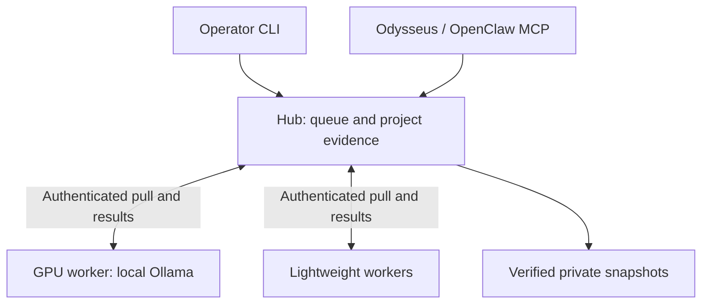

# Home Lab companion

An opt-in coordination and recovery layer for a small personal AI lab. It adds durable jobs, attributable project knowledge, and tested snapshots around the existing Odysseus application.

**Status: implementation candidate.** The automated tests and synthetic demonstration exercise real local HTTP, SQLite, worker code, retrieval, and recovery. Physical-host deployment, actual model quality, private-network reachability, and unattended reboot still require the [host acceptance record](docs/HOST-ACCEPTANCE.md).

Odysseus already has personal memory, document RAG, scheduling, and MCP support. This companion keeps that foundation authoritative and adds the missing cross-machine coordination and project evidence. It does not require changes to existing application configuration or data.

## Project Factory v0.1 (stacked implementation candidate)

The new [Project Factory runbook](docs/PROJECT-FACTORY.md) documents a
durable, dependency-aware mission journal and approval/evidence CLI atop the
**existing** queue. No general-purpose code execution or second scheduler is
introduced. Try `python factory.py demo --output <new-private-directory>`
to exercise real authenticated HTTP workers, pinned repository input
verification, restart, evidence, approval and SQLite snapshot/restore on **one
host**. This does not verify the physical three-node lab or resolve required
repository security checks.

## Start with a complete demonstration

Requires Python **3.10+ with SQLite FTS5**. The core has no third-party dependencies. From this directory, choose a new output path outside the checkout:

```sh
python3 lab.py demo --output "$HOME/odysseus-homelab-demo"
```

Windows PowerShell:

```powershell
py -3 lab.py demo --output "$env:LOCALAPPDATA\OdysseusHomelab-demo"
```

This executes synthetic jobs through three independently authenticated worker roles on **one computer**, checks hashes and source citations, reopens the queue, and verifies a snapshot/restore. It writes `DEMO-RESULT.json`. It does not download a model, contact a cloud API, or prove that three physical machines are connected. The output directory contains private test credentials; keep it outside Git.

## Architecture and placement

| Role | Responsibility | Default capability |
| --- | --- | --- |
| `hub` | One authoritative queue and knowledge store; lightweight worker in a separate process | `text.hash`, `json.validate` |
| `gpu` | Local Ollama inference on the GPU host | Above plus `ollama.generate` |
| `mac` | Operator console and optional lightweight worker | `text.hash`, `json.validate` |
| Project reader | Read-only CLI/MCP access to one project | Status, job results, source search |



One active leased job per node is the default. Capabilities and exact model allowlists determine eligible workers; an optional `target_node` pins a job. Unavailable workers leave queued work durable. There is no silent cloud fallback. The database stays on the hub's local disk; remote machines use the API, never a shared SQLite file.

Lease recovery can repeat computation. Fencing prevents an expired attempt from committing over a newer result; it is not an exactly-once execution guarantee.

## What is implemented

- **Durable orchestration:** atomic claims, expiring fenced leases, heartbeats, bounded retries/backoff, project-scoped idempotency, cancellation, node freshness, and admission limits.
- **Fixed local tasks:** SHA-256 text hashing, JSON-object/required-key validation, and bounded local Ollama generation. No arbitrary shell executor or automatic model installation.
- **Persistent knowledge:** explicit nonoverlapping project roots, dry-run scanning, UTF-8 document/code ingestion, SQLite full-text search, exact SHA-256/line/character provenance, stale-source withholding, authored notes/decisions/inferences, and optional local embeddings with visible lexical fallback.
- **Scoped access:** distinct administrator, node, and project reader credentials; loopback listener; HTTPS for remote credential transport; no credential redirects. Read-only MCP exposes `lab_status`, `lab_jobs`, `lab_job`, and `project_search`.
- **Operations:** local diagnostics, consistent SQLite snapshots, tamper/integrity checks, disarmed restore with credential rotation, a pull-only Git mirror, and native foreground/user-login launchers.

`json.validate` checks shape, not whether a model's answer is factually correct. A model result is evidence to review, not permission to execute an instruction. Retrieved source text is explicitly marked untrusted.

## Deployment and daily use

1. Follow [RUNBOOK.md](docs/RUNBOOK.md) to start the hub and a lightweight worker with a small public corpus.
2. Add private transport, then the GPU worker using existing locally installed models.
3. Connect one project reader to Odysseus or OpenClaw through MCP.
4. Complete [HOST-ACCEPTANCE.md](docs/HOST-ACCEPTANCE.md), including a recovery drill and a real-model usefulness check.

For a local coding agent, use [CODEX-HANDOFF.md](docs/CODEX-HANDOFF.md). It identifies the entry point, existing-system boundaries, and the work to execute on the actual machines.

| Reference | Contents |
| --- | --- |
| [Runbook](docs/RUNBOOK.md) | Commands, private networking, worker enrollment, first useful workflow, MCP |
| [Knowledge](docs/KNOWLEDGE.md) | Ingestion exclusions, citations, authored memory, embedding behavior |
| [Operations](docs/OPERATIONS.md) | Startup, backup coverage, restore, Git mirrors, optional self-hosted services |
| [Design](docs/DESIGN.md) | Goals, authority boundaries, acceptance criteria |
| [Verification](docs/VERIFICATION.md) | Tested behavior and remaining evidence gaps |

## Tests

```sh
python3 -m unittest discover -s tests -v
python3 -m compileall -q homelab lab.py
```

The optional real MCP protocol test skips when the SDK is absent. To include it, create a separate environment and install `requirements-mcp.txt`; do not replace an existing Odysseus environment just to run this companion. The GitHub workflow runs core tests on Linux, Windows, and macOS and a separate MCP/Python-floor job.

## Current boundaries

This is a single-hub personal-lab service, with durable recovery rather than automatic failover. The hub must be awake to dispatch work. Supplied startup installers start at user login, not before login after a reboot. Queue capacity covers the companion's leases; existing Odysseus, OpenClaw, and other Ollama clients also consume resources. Cancellation rejects a late result but cannot guarantee that an in-flight model computation stops immediately.

Cloud execution, ComfyUI jobs, workflow DAGs, automatic document watching, PDF/OCR ingestion, a browser dashboard, automatic backup schedules, and an artifact server are not implemented. Add them against measured needs and the same recovery/access boundaries. Current jobs and indexed text are bounded; there is no general disk-quota/retention controller. Snapshots include credentials and indexed text and are unencrypted until an external encrypted backup tool protects them.
